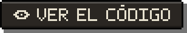
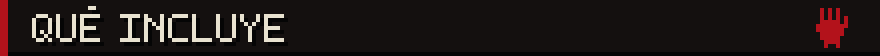
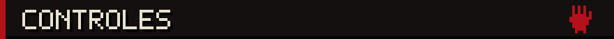
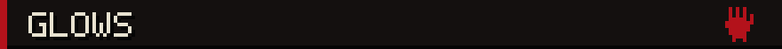
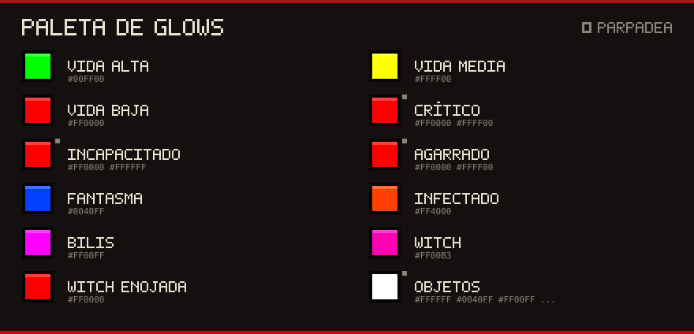

<div align="center">



<br>


**Mi autoexec de L4D2, limpio y listo para copiar y pegar.**<br>
Null movement, red y LERP, FOV, viewmodel y glows de colores que parpadean cuando importa.

<br>

<a href="https://github.com/eito-tv/Autoexec-sencillon/raw/main/autoexec.cfg"></a>
&nbsp;
<a href="autoexec.cfg"></a>

</div>

<br>


1. **Descarga** el archivo con el botón de arriba (si se abre como texto, usa <kbd>Ctrl</kbd> + <kbd>S</kbd> y guárdalo como `autoexec.cfg`).
2. **Cópialo** a la carpeta `cfg` del juego:
   ```
   C:\Program Files (x86)\Steam\steamapps\common\Left 4 Dead 2\left4dead2\cfg\
   ```
   > En Steam: clic derecho en Left 4 Dead 2 → **Administrar** → **Ver archivos locales** → `left4dead2` → `cfg`.
3. **Ábrelo con el juego.** Se carga solo al iniciar. Si no, añade esto en
   **Propiedades → General → Opciones de lanzamiento**:
   ```
   +exec autoexec
   ```
4. Al entrar verás en consola: `Competitive Pack cargado.` ✔

<br>



| | Función | Qué hace |
|:-:|---|---|
| 🏃 | **Null movement** | Si pulsas dos direcciones opuestas (A + D), gana la última. Strafes más limpios. |
| 🌐 | **Red** | `rate 100000`, `cl_cmdrate 100`, `cl_updaterate 100`. |
| 🎯 | **LERP** | `cl_interp 0.050` con `cl_interp_ratio 0`. |
| 🔭 | **FOV** | Cambia entre 90 · 95 · 100 · 110 · 120. |
| 🔫 | **Viewmodel** | Cambia el tamaño del arma entre 60 · 100 · 130 · 180. |
| 🟢 | **Glows de colores** | Colores intensos por estado: vida, infectados, Witch, bilis y objetos. |
| 🚨 | **Glows con parpadeo** | Crítico, incapacitado y agarrado parpadean para que se vean al instante. |
| 💬 | **Mensaje de equipo** | Una tecla para avisar `BACK BACK BACK` al equipo. |

<br>



| Tecla | Acción |
|:-:|---|
| <kbd>W</kbd> <kbd>A</kbd> <kbd>S</kbd> <kbd>D</kbd> | Movimiento con null movement |
| <kbd>F8</kbd> | Abrir / cerrar la consola |
| <kbd>,</kbd> | Siguiente FOV |
| <kbd>.</kbd> | Siguiente tamaño de viewmodel |
| <kbd>B</kbd> | `say_team BACK BACK BACK…` |

<sub>¿Quieres otra tecla? Abre `autoexec.cfg` con el Bloc de notas y cambia la letra entre comillas en la línea `bind`.</sub>

<br>



<div align="center">

</div>

- **Crítico:** rojo ↔ amarillo, lento.
- **Incapacitado:** rojo ↔ blanco, muy rápido.
- **Agarrado** (Hunter, Smoker, Charger, Jockey): rojo ↔ amarillo, rapidísimo.
- **Objetos:** ciclo de colores para que las armas y botiquines no se pierdan de vista.

<br>


<details>
<summary><b>¿Me pueden banear por usarlo?</b></summary>
<br>
No. Es un archivo de texto con comandos y binds del propio juego, lo mismo que escribirías en la consola. No modifica archivos del juego ni instala nada.
</details>

<details>
<summary><b>Los glows no parpadean en algunos servidores</b></summary>
<br>
Los parpadeos usan el comando <code>wait</code>. Algunos servidores lo desactivan; ahí los glows se quedan en su color fijo y todo lo demás sigue funcionando.
</details>

<details>
<summary><b>¿Cómo lo quito?</b></summary>
<br>
Borra <code>autoexec.cfg</code> de la carpeta <code>cfg</code>. Los binds quedan guardados en tu configuración, así que restablece las teclas en <b>Opciones → Teclado/Ratón</b>.
</details>

<details>
<summary><b>¿Puedo cambiar los colores?</b></summary>
<br>
Sí. Cada color está comentado en el archivo y usa valores de <code>0.0</code> a <code>1.0</code> para rojo, verde y azul (<code>_r</code>, <code>_g</code>, <code>_b</code>).
</details>

<br>

<div align="center">

Hecho por **[EITO](https://github.com/eito-tv)** · si te sirvió, deja una ⭐ al repo

</div>
